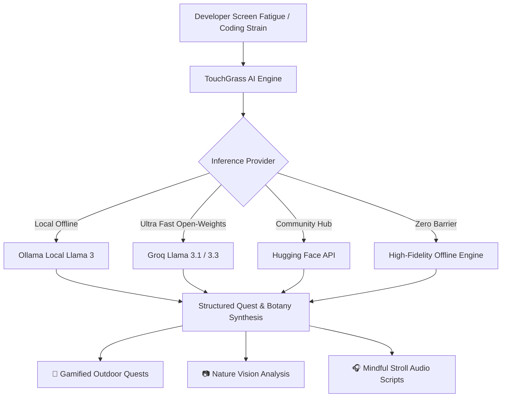

# 🌿 TouchGrass AI
> **The Open-Source Nature & Outdoor Quest Companion for Software Developers.**  
> *Built for the Hacktoberfest 2026 Week 1 Challenge (Theme: "Touch Grass").*

[](https://opensource.org/licenses/MIT)
[](https://www.python.org/)
[](https://streamlit.io/)
[](https://github.com/meta-llama/llama3)

---

## 💡 Why TouchGrass AI?

As software engineers, we've all been there: staring at an impenetrable concurrency deadlock or CSS layout bug for 6 continuous hours until our eyes sting, our shoulders knot up, and our cognitive focus spirals into brain fog and frustration.

The internet's classic advice is simple: **"Go touch grass."**

**TouchGrass AI** transforms that meme into an intelligent, science-backed outdoor companion. Powered by **open-source AI models (Meta Llama 3 open weights, local Ollama, and Hugging Face)**, it dynamically diagnoses your coding fatigue and synthesizes hyper-targeted, gamified outdoor micro-adventures to reset your neurotransmitters, relax your ciliary eye muscles, and restore your cognitive clarity.

---

## ✨ Key Features

### 1. 🎯 Custom Dopamine & Sunlight Reset Quests
- Input your screen hours, current engineering task (debugging, PR reviews, LeetCode grind), and physical symptoms (dry eyes, neck stiffness, tunnel vision).
- Open-source AI synthesizes a personalized 10-15 minute outdoor quest with concrete sensory objectives (e.g. 20-foot distant focal resets, botanical texture discovery, diaphragmatic breathing).
- Includes the **Neuroscience Rationale** behind why the specific outdoor activity resets your prefrontal cortex.

### 2. 📷 Nature Vision & Flora Field Guide
- Stepped away from your desk and spotted an interesting leaf, tree, wildflower, or cloud formation?
- Upload a photo or select an observation sample.
- The AI acts as your botanical field guide—identifying species candidates, explaining ecological roles, and sharing mindfulness trivia that rewards you with "Nature Points".

### 3. 🎧 Mindful Walking Meditation Guide
- Put on your earbuds, keep your phone in your pocket, and let TouchGrass AI guide your walk.
- Generates a calming 4-phase walking meditation script to dissolve bug loops from your working memory.

### 4. 🏆 Gamified Outdoor Streaks & Badges
- Track your "Grass-Touched Streak" and total minutes spent outdoors.
- Unlock badges: *🌿 First Grass Touched*, *☀️ Sunlight Synthesizer*, *🍃 Botanical Explorer*, and *🧘‍♂️ Code Detox Master*.

---

## 🧠 Open-Source AI Architecture

TouchGrass AI is designed with an **open-first, local-friendly philosophy**:
- **Groq Cloud Inference:** Ultra-fast open-weight models (`llama-3.1-8b-instant`, `llama-3.3-70b-versatile`).
- **Local Ollama Support:** 100% private, offline inference running entirely on your machine (`http://localhost:11434`).
- **Hugging Face API:** Seamless integration with open-access community models.
- **Built-in Offline Engine:** Zero-barrier simulation mode so developers can test the entire workflow with zero API keys required.



---

## 🚀 Quick Start

### 1. Clone the repository
```bash
git clone https://github.com/VimalN2005/touch-grass-ai.git
cd touch-grass-ai
```

### 2. Install dependencies
```bash
pip install -r requirements.txt
```

### 3. Run the interactive Streamlit app
```bash
streamlit run app.py
```

Open your browser at `http://localhost:8501`.

---

## 🧪 Running Tests
TouchGrass AI includes automated test coverage for AI inference and fallback engines:
```bash
pytest
```

---

## 📜 License
Released under the **MIT License**. Created with ❤️ by **Vimal Sahani** ([@VimalN2005](https://github.com/VimalN2005)) for Hacktoberfest 2026.
